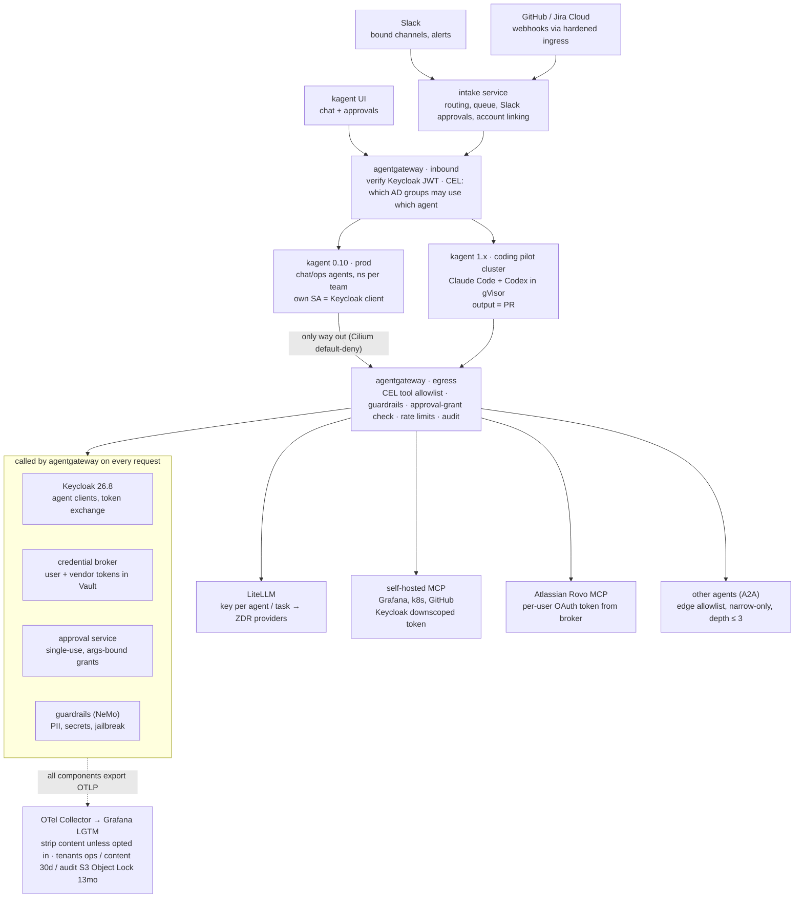

# Governed Agent Platform — Architecture

As of 2026-10-10. Published copy, for sharing with security: https://claude.ai/code/artifact/241c66e4-fa91-451b-b69a-b0d2a6aa0dfa

Decisions are referenced as `Dn`. They are indexed at the end of this document and expanded in [`adr/`](adr/).

## Context and goals

We will build a governed agent platform on our self-hosted kagent. Every agent gets its own non-human identity, and every agent call passes through gateways we control. We onboard an external agent platform only if it clearly beats what we can build.

**Current estate:**

- kagent 0.10.x, with login through Keycloak.
- agentgateway 1.5.
- Kubernetes on Talos Linux (bare metal and VMs), with Cilium, Kyverno and Argo CD.
- Grafana LGTM on AWS S3.
- Keycloak (DevOps-owned, users from AD) and Okta (IT-owned). The two run in parallel and are not federated.
- HashiCorp Vault + External Secrets, and Artifactory.
- LiteLLM holds every LLM key. Zero-data-retention (ZDR) terms are in place with every provider.

About 1,000 engineers use these systems. Compliance scope is ISO 27001 and SOC 2.

**What security asked for:** control over what agents can call, and agent identities that are separate from human identities. The risk is that an agent acting with a human's often over-broad permissions causes damage at machine speed.

**What the platform must also cover:**

- Persistent memory and retention.
- Tracing, telemetry and logs.
- Context management.
- Slack now, and Teams/Outlook later.
- Remote coding agents (Claude Code and Codex), triggered from GitHub issues, Jira tickets or Slack.

**Order of work (D1):**

1. A thin governance foundation.
2. A coding-agent pilot with one team.
3. Chat/ops agents across teams.

No agent touches a real system before the foundation is in place. That way security approves the platform once, not each agent.

## Design principles

1. **Every agent has its own identity (D3).** An agent authenticates as itself, never as a person. Its identity is a Keycloak client bound to its Kubernetes ServiceAccount.
2. **A human can only narrow an agent's permissions, never widen them (D3).** When a person starts a task, effective permissions = intersection(agent's allowed scopes, that person's permissions).
3. **Agents never hold human credentials (D3, D45).** User and vendor tokens stay with platform components.
4. **Every call passes through a chokepoint (D5).**
   - Model calls go through LiteLLM.
   - Tool (MCP) and agent-to-agent (A2A) calls go through agentgateway.
   - Internet access goes through an allowlisted proxy.
   - Everything else is denied at the network layer.
5. **No standing credentials (D5).** Short-lived tokens are minted per call or per task, so a kill switch is a policy change, not a secret hunt.
6. **Agents are code (D6).** Agents, tool bindings and policies live in Git, are deployed by Argo CD, and are checked by Kyverno guardrails.
7. **Rules first, models only where rules can't do the job (D49).** Deterministic checks are predictable, testable and cheap. A model-based judge is added only for a control that rules can't express.
8. **An agent is anything that decides and acts (D48).** We govern agents by identity and action, not by protocol. That includes agents we don't run: local harnesses on laptops and agents inside SaaS products.

## Target architecture

**What we build in-house.** There are five small components; everything else is configuration of products we already run. Their API contracts are in [`services/`](../services/).

| Component | Job | Phase |
| --- | --- | --- |
| intake service | Slack Socket Mode, GitHub/Jira webhooks, queue, routing, Slack approval buttons | 1 (Slack), 2 (GitHub/Jira) |
| credential broker | Account linking for Keycloak and Atlassian; RFC 8693 token endpoint for agentgateway; refresh, revoke, connected-accounts page | 1 |
| approval service | Mints single-use, argument-bound grants; verified by ext_authz and by T2 tool servers | 1 |
| guardrails adapter | Translates agentgateway's MCP guardrail and LLM webhook calls into NeMo Guardrails `/v1/checks` | 1 |
| knowledge MCP | Curated, read-only team knowledge from Git and Confluence | 3 |

## Identity and access

Keycloak is the identity plane for agents (D11), and Okta stays the sign-in for SaaS apps. Keycloak is owned by DevOps, already holds every engineer from AD, and supports what we need natively.

### How an agent proves who it is

- Each agent is a Keycloak confidential client. It authenticates with its own Kubernetes ServiceAccount token, so it has no stored secret. Keycloak has supported this since 26.6 ([release](https://www.keycloak.org/2026/04/keycloak-2660-released), [how it works](https://www.keycloak.org/2026/01/federated-client-authentication)).
- **Action:** we run about 26.5 today. Upgrade to **26.8**, which adds the `act` ("acting for") claim as a Preview feature. Until `act` is GA, the agent ID goes in a custom claim (`agent_id`).
- **Talos prerequisite:** Keycloak must be able to reach the cluster's OIDC discovery endpoint. The ServiceAccount token's `aud` must be the realm issuer URL.

### How the intersection rule is enforced

- **Narrowing the token.** Keycloak [token exchange V2](https://www.keycloak.org/securing-apps/token-exchange) turns the user's token into one for a specific tool's audience.
  - The audience can only narrow what the user already has.
  - The `downscope-assertion-grant-enforcer` client policy stops scopes from being added.
- **Checking the target system.** Tool servers then check the user's real permission there, for example their GitHub repo role.

### Which identity each kind of run uses

| Run type | Identity presented to tools | Example |
| --- | --- | --- |
| Started by a person (UI, Slack) | Exchanged token: `sub=user`, `act=agent`, scopes = agent ∩ user | "Summarise errors for my service" in the kagent UI |
| Autonomous (webhook, schedule) | Agent's own identity only | Auto-triage of a new GitHub bug report |
| Agent calling another agent | Re-exchanged at each hop, narrower or equal, `act` chain recorded | Triage agent asks the Kubernetes agent for pod status |

### Linking a user's account (D12)

Slack can't reach Keycloak or Vault, so our in-cluster intake service and credential broker do the linking:

1. The intake service DMs the user a link.
2. The user's browser logs in to Keycloak on the corporate network.
3. The broker stores the refresh token in Vault.

The agent never sees any user token.

### Who may use which agent (D25)

Open-source kagent has no per-agent access control. Its login mode (`controller.auth.mode: trusted-proxy`) also decodes JWTs **without verifying the signature or expiry** ([kagent docs](https://github.com/kagent-dev/kagent/blob/main/docs/architecture/oidc-proxy-authentication.md)). agentgateway therefore becomes the single policy enforcement point in front of every way into kagent: the UI API, the A2A endpoints, the intake service and agent-to-agent calls.

- It verifies Keycloak JWTs.
- CEL rules map AD/Keycloak groups to agents.
  - The rules are generated from the `platform.example.com/owner` and `/audience` labels on each Agent CRD.
  - Kyverno rejects any agent without those labels.
- AD groups are the source of truth for teams (D41). Each group maps to a namespace, an ACL, a budget and its approvers.

### Agent-to-agent calls (D21)

- **Allowed edges.** "Agent X may call agent Y" is an allowlist in Git, enforced at agentgateway. A cross-team edge must be approved by the team that owns the agent being called.
- **Each hop.** Each hop narrows the token or keeps it equal, and call depth is capped at 3.
- **What gets passed.** The caller passes a task brief plus references to artifacts, with access scoped to the task. It never forwards its full history, because that history carries whatever untrusted content the caller has seen.
- **What gets said (D47).** An allowed edge doesn't mean every message over it is allowed. agentgateway sends every A2A exchange to the guardrails adapter (`extProc`, [ADR 0016](adr/0016-a2a-content-inspection.md)).
  - Requests are held in full and checked before forwarding. Briefs are short, so this is cheap.
  - Responses are checked as they stream.
  - Rules can depend on the caller, the callee and whether the edge crosses teams.
  - Phase 1 uses rules only. The semantic judge comes in phase 3, on cross-team edges.

## Controlling agent calls

Every agent call leaves through agentgateway, where it is authenticated, checked against policy, inspected and logged. Network policy makes any other route impossible.

### Chokepoints (D5, D30, D36)

- **Network:** Cilium default-deny egress in agent namespaces. The only allowed destinations are agentgateway and the egress proxy.
- **Model calls:** agent → agentgateway → LiteLLM.
  - LiteLLM stays the authority for keys and budgets, and agentgateway's own LLM-gateway features stay off.
  - The agent never holds a LiteLLM key. On kagent 0.10, the gateway strips the agent's placeholder key, injects its own LiteLLM credential, and stamps `x-agent-id` from the calling pod's workload identity. LiteLLM tracks spend and budgets per agent on that header.
  - Each coding task gets its own key with a budget and expiry, minted by intake.
  - Budgets are set per team.
- **Data:** ZDR terms are in place with every provider behind LiteLLM, so any data class may be sent to models.

### Tools (MCP servers) (D13, D38, D43)

Every MCP server is reached only through agentgateway. The agent's Keycloak token is never passed through to the tool server ([MCP authorization spec](https://modelcontextprotocol.io/specification/2026-07-28/basic/authorization/security-considerations)).

| Tool server | Hosted by | How it authenticates downstream | v1 scope |
| --- | --- | --- | --- |
| Grafana MCP | Us | Grafana service-account token from Vault, injected server-side | Read (T0) |
| Kubernetes, Argo CD (kagent-tools) | Us | Short-lived Kubernetes tokens from Vault | Read; Argo sync in non-prod |
| GitHub | Us | GitHub App installation token per call | T0/T1 |
| Atlassian Rovo MCP (Jira, Confluence) | Atlassian | The user's own Atlassian OAuth token, held by the broker | T0/T1 |

ServiceNow is out of scope (D46).

### Vendor OAuth: the gateway holds the tokens (D42, D45)

1. **Not linked yet.** agentgateway's ext_authz check finds the user hasn't linked their vendor account. It returns a connect URL as a JSON-RPC error in the -32042 style.
2. **Linking.** The user signs in to the vendor through our **credential broker**. The broker stores the tokens in Vault at `mcp-tokens/atlassian/{kc_sub}`.
3. **Each call.** Open-source agentgateway's `oauthTokenExchange` backend policy asks the broker's RFC 8693 endpoint for that user's token. The gateway attaches it after the CEL tool allowlist and guardrails have run.
   - The broker refreshes tokens with single-flight locking, because Atlassian rotates refresh tokens.
   - The broker keys on `sub` and ignores `act`.
4. **Disconnecting** revokes the token at the vendor and deletes it from Vault.

Solo's paid Enterprise edition does this natively ([agentgateway #239](https://github.com/agentgateway/agentgateway/issues/239)); we build the broker instead. Keycloak can't be the token store for Atlassian: Atlassian isn't a full OIDC provider, and Keycloak's generic OAuth 2.0 provider doesn't refresh tokens through the V2 API.

### Risk tiers and approvals (D4, D14, D29)

| Tier | What it covers | Approval |
| --- | --- | --- |
| T0 | Read-only | None |
| T1 | Reversible writes: open a PR, comment, create a ticket, non-prod sync | None if in policy |
| T2 | Irreversible, prod-impacting or externally visible actions | A named human. Prod = four-eyes from the owning team; the requester can't approve their own |

- kagent's `requireApproval` (or the harness's own permission prompt) is the user experience.
- **The approval service is the actual control.** It mints a signed, single-use grant. The grant is bound to the exact tool and the SHA-256 of its canonicalised arguments, and is valid for about 15 minutes.
- **Enforcement.** T2 tool servers reject calls without a valid grant. For vendor MCP servers, agentgateway's ext_authz checks the grant instead.
- **Prod changes.** Changes managed by Argo CD happen only through GitOps PRs. Direct prod writes are limited to an allowlist of ops actions (restart, scale, cordon), with four-eyes approval.

### Guardrails (D23, D34)

Guardrails are a second layer of defence, behind identity and approvals.

- **One check service** runs [NeMo Guardrails](https://github.com/NVIDIA-NeMo/Guardrails) (`/v1/checks`). It is called from four places:
  - a LiteLLM custom guardrail;
  - agentgateway's LLM webhook;
  - agentgateway's `mcpGuardrails` hook on `tools/call`;
  - agentgateway's `extProc` on the A2A route (D47).
- **Phase 1** runs on CPU: regex, PII and secret checks, plus JailbreakDetect.
- **Phase 3: an LLM judge** (D49, [ADR 0018](adr/0018-semantic-check-runtime-rules.md)). It uses a small approved model through LiteLLM, with no GPU. It is added only for controls that rules can't express. When it runs depends on the tier:

  | Tier | When the judge runs | If the judge is down | When it flags something |
  | --- | --- | --- | --- |
  | T0 | After the call | Allow, and alert | Alert; counts toward the auto-trip |
  | T1, and cross-team A2A | On the request before forwarding; on the response after delivery | Allow, and alert | Block the request; alert on the response |
  | T2 | On the request before the approval prompt; on the full buffered response | Block | Shown to the approver as advice; they may override with a written reason |

  - Every verdict goes to the audit tenant, with the control, policy version, judge model, input hash, verdict, latency and any override.
  - A labelled sample set runs in CI next to garak and tracks precision and recall per control.
- **Red-teaming:** [garak](https://github.com/NVIDIA/garak) runs against LiteLLM in CI. Its reports also serve as ISO 27001 and SOC 2 evidence.

### Kill switches and limits (D39)

See [`runbooks/kill-switch.md`](runbooks/kill-switch.md).

- **Manual switches, from fastest to slowest:**
  1. A deny-all rule for the agent at agentgateway.
  2. Revoke its LiteLLM key.
  3. Disable its Keycloak client.
  4. Scale it to zero.
- **Global freeze:** stops every agent at once.
- **Auto-trips** suspend the agent and page its owner when any of these happens:
  - a budget overrun;
  - a tool-call rate spike;
  - repeated guardrail violations;
  - repeated approval denials;
  - an A2A loop.
- **Limits:**
  - Rate limits per agent and per team.
  - A coding task is capped at 60 minutes and $20.

## Observability, memory and data

By default, telemetry records who did what, not what was said. Full content is captured only for agents that opt in. The audit trail is write-once for 13 months.

### Telemetry pipeline (D9, D19, D32)

kagent, agentgateway, LiteLLM, the coding harnesses and our services all export OTLP to one OpenTelemetry Collector. kagent always writes tool arguments and results into spans, even when message capture is off ([tracing docs](https://kagent.dev/docs/kagent/1.x/observability/tracing.md)). So the Collector strips `gen_ai` content and tool argument/result attributes unless the agent has opted in.

| LGTM tenant | What goes there | Retention | Who can read it |
| --- | --- | --- | --- |
| ops | Metrics, metadata-only traces, service logs | Standard | Engineering |
| content | Prompts, responses and tool arguments for opted-in agents; coding-agent transcripts | 30 days | Platform on-call + the agent's owner |
| audit | Gateway access logs, approval events, intake events, kagent controller audit | 13 months, AWS S3 Object Lock | Security + platform |

- **Opting in:** an agent opts in with the annotation `platform.example.com/capture-content: "true"`. Security approves it through CODEOWNERS.
- **Coding-agent transcripts** are captured by default, because reviewers need the reasoning behind a PR.

### Activity map: who talked to whom, and when (D50)

Grafana dashboards on the existing LGTM stack ([ADR 0019](adr/0019-agent-activity-map.md)):

- **Live map.** A node-graph panel showing agent → tool → agent, built from gateway access logs and metrics with an added `caller_agent` field. Tempo service graphs can't separate agents, because every call passes through the same gateway node.
- **Interaction log.** Each gateway call from the audit tenant, with time, agent, user, target, result and latency.
- **Declared vs used.** Edges and tools unused for 30 days are flagged to their owner for removal at recertification.
- **Registry view.** Every agent of every kind (D48), with its owner, tier, tools, edges, spend and last activity.

### Sessions, memory and context (D10, D31)

- **Sessions** are stored in kagent's Postgres and kept 90 days, using kagent 0.10.3's built-in `database.postgres.sessionRetentionDays: 90`.
- **Context compaction** is on, so long sessions stay inside the model's context window.
- **Long-term memory is off in v1.** kagent's memory is per agent *and per user*, and needs pgvector. Per-user memory is where cross-user leaks and memory poisoning happen.
- **Team knowledge** comes from a curated, read-only knowledge MCP built from runbooks and ADRs. Changes go through PRs.
- **Untrusted content stays out of memory.** Tool output (issue bodies, emails, logs) is never auto-written to memory.

## Coding agents (D7, D15, D16, D18, D24, D37, D41)

Claude Code and Codex run headless in gVisor sandboxes on our cluster. All model calls go through LiteLLM, and the only output is a PR that a human must review.

### Harnesses

- **Only two options keep everything in-house.** The **Claude Code CLI** and the **Codex CLI**, run in our own pods, are the only ones that send every model call through LiteLLM ([Claude Code LLM gateway](https://code.claude.com/docs/en/llm-gateway.md), [Codex via LiteLLM](https://docs.litellm.ai/docs/proxy/client_setup/codex_cli)).
- **Vendor "self-hosted worker" products are out.** Cursor's self-hosted agents, Claude Code's self-hosted environments and Codex cloud all keep the agent loop and model calls on the vendor's side, which breaks the residency rule.
- **Cursor** stays a desktop IDE, parked for remote use (D28).

### Runtime

- **kagent 1.0 (alpha) is a rewrite.** Its `Harness` resource runs `claude` or `codex` runtimes. Every agent is sandboxed (gVisor or a Kata microVM), and agentgateway is built in as a default-deny egress gateway ([1.0 notes](https://kagent.dev/docs/kagent/1.x/reference/release-notes/1.0.md)).
- **Separate cluster.** 1.x can't share a cluster with 0.10 and has no in-place upgrade, so the pilot runs on a **separate cluster**.
- **Fallback:** stay on 0.10 and write our own dispatcher on [agent-sandbox](https://github.com/kubernetes-sigs/agent-sandbox) (`SandboxTemplate`/`SandboxClaim` v1beta1), using Talos's `gvisor` RuntimeClass.

### Triggers

The text of an issue, ticket or Slack message is untrusted input.

- **Automatic:** every new bug report gets read-only triage. That means an analysis comment, the likely files, and a repro attempt.
- **Code changes** need an explicit trigger from someone with repo write access:
  - a GitHub label (`agent:claude` / `agent:codex`) or a `/agent` comment;
  - a Jira label or transition;
  - a Slack command in a bound channel.
- **Repos opt in** through an allowlist plus `.agent-platform.yaml` in the repo. Bitbucket DC comes later.

### Git identity and CI safety

- **One GitHub App per harness.** Each task gets an installation token scoped to one repo that expires after 1 hour.
- **Rulesets** stop the Apps from pushing to the default branch, approving PRs or merging.
- **Attribution:** commits carry `Co-authored-by` for the requester.
- **CI secrets** come from Vault via GitHub OIDC. **Check:** the Vault roles must be bound to protected refs.
- **Sandbox contents:** no prod secrets. Skills (OCI) and packages come from Artifactory.

### Pilot

- One team of 10–20 engineers, on 3–5 repos.
- At most 20 concurrent tasks across the platform, and 5 per team.
- Each task is capped at 60 minutes and $20.

## Channels and intake (D22, D26, D27, D35)

| Surface | Used for | When |
| --- | --- | --- |
| kagent UI (behind agentgateway) | Chat, approval prompts, session history | Phase 1 |
| Slack (one app, Socket Mode) | Channel-bound agents, notifications, approvals for autonomous runs with a UI deep link | Phase 1 |
| GitHub / Jira Cloud webhooks | Coding triggers, auto-triage | Phase 2 |
| Microsoft Teams (bot) | Chat for Teams users | Phase 3, after IT confirms Entra |
| Outlook (app-only Graph) | Shared-mailbox triage and drafts; sending is T2 | Phase 3, after IT confirms Entra |

**The intake service** replaces today's single Slack adapter.

- **Routing:** by channel binding (declared in Git), by explicit addressing (`/agent <name>`), or through an optional concierge agent.
- **Scaling:** replicas are stateless and events go onto a queue. Postgres maps each Slack thread to its A2A `contextId`.
- **Approvals:** `INPUT_REQUIRED` approval prompts render as Slack buttons. The service enforces the four-eyes rule.
- **Status updates** go to GitHub and Jira with the service's own app credentials.

**Webhook ingress** is public and webhook-only:

- HMAC signatures are verified.
- Source IPs are allowlisted from GitHub's `meta` API and Atlassian's published ranges.
- Events go straight onto the queue.

**Microsoft 365.**

- Graph only accepts Entra-issued tokens.
- Teams messages are posted through a bot.
- Outlook access is limited to specific shared mailboxes with [Exchange RBAC for Applications](https://learn.microsoft.com/graph/auth-limit-mailbox-access), and the tenant-wide `Mail.Read` grant is removed.

## Agent lifecycle and governance (D6, D33, D40)

1. **Onboarding PR** in the team's GitOps folder. It declares the owner (an AD group), the audience, the tools with their risk tiers, the data classes and the A2A edges. Kyverno rejects any agent missing these. A T2 tool or a content-capture opt-in needs security CODEOWNERS approval.
2. **Non-prod first.** The agent must pass a task-eval suite and a garak run before Argo CD promotes it.
3. **Prod**, under the controls in this document.
4. **Quarterly re-certification** of identity, tools, budgets and edges by the owner.
5. **Auto-disable** after 90 days with no owner or no use.

An **agent registry** is the inventory auditors see. New MCP servers go through the same security-review PR, with a tier for each tool. Skills are pulled from Artifactory as OCI artifacts and aren't signed in v1.

### Agents we don't run (D48)

The registry covers three kinds of agent ([ADR 0017](adr/0017-agents-we-dont-run.md)):

| Kind | Examples | Phase 1 | Phase 3 controls |
| --- | --- | --- | --- |
| Platform | kagent agents, coding sandboxes | From the CRDs | Everything in this document |
| Local | Claude Code, Codex, Cursor on laptops | From LiteLLM key owners and client names | Managed harness config that routes model and MCP traffic through LiteLLM and agentgateway. A Keycloak client per harness, so the gateway can apply agent-style limits, including grants for T2 tools |
| SaaS | Atlassian Rovo, GitHub Copilot, Slack AI, M365 Copilot | From vendor admin consoles and Okta | Only approved OAuth apps and agent features; quarterly grant review; new ones go through the vendor gate |

Local agents still act as the human, so the intersection rule doesn't apply to them. The controls above add limits on top of the human's own rights.

## Vendor and build-vs-buy evaluation (D8, D25, D28)

**Gate:** a vendor platform must meet all five of these.

1. Okta SSO + SCIM, and per-agent non-human identities.
2. Calls go through our gateways, or it exports a full audit trail to LGTM.
3. ZDR, data residency, and SOC 2 Type II.
4. A capability we can't build within about 2 quarters.
5. Agents and memory stay portable (MCP / A2A).

| Option | Verdict |
| --- | --- |
| Grok Bot (SpaceX AI) | **No**, unless building it ourselves proves infeasible. It's a SaaS agent running in Cursor's cloud, a second governance plane, with no self-hosted option |
| Cursor self-hosted agents | **Parked.** The agent loop and model calls stay in Cursor's cloud, and it can't use LiteLLM. SpaceX acquired Cursor on 2026-08-14 |
| Solo Enterprise (kagent / agentgateway) | **Not now.** We build the authorizer (CEL) and the credential broker on open source |
| NeMo Guardrails + garak | **Adopt** |
| NVIDIA OpenShell | **Skip for now.** Incompatible with gVisor, and its audit is best-effort. Revisit in 2027 |
| NeMo Agent Toolkit / Helix | **Skip.** Duplicates kagent, LGTM and Argo CD |
| Coder Tasks, OpenHands, other open-source orchestrators | **Skip.** None covers our trigger × harness × Kubernetes combination |
| Okta for AI Agents | **Later**, for SaaS apps that support Cross App Access |
| Dataiku (LLM Mesh, Agent Hub, Govern, Agent Management) | **No.** No identity per agent; it enforces policy on LLM calls only; the chat user approves their own tool calls. Agent Management inventories agents but is [not a gateway](https://www.dataiku.com/product/agent-management). We copy its ideas instead (see the published doc's Dataiku comparison tab) |

## Roadmap

See [`roadmap.md`](roadmap.md) for phase contents and the phase-1 acceptance tests that form the security gate.

```mermaid
gantt
  dateFormat  X
  axisFormat  wk %s
  section Phases
  Phase 0 · urgent fixes            :p0, 0, 2
  Phase 1 · governance foundation   :p1, 2, 10
  Phase 2 · coding-agent pilot      :p2, 8, 16
  Phase 3 · scale-out (open-ended)  :p3, 16, 20
  section Gate
  Security gate · acceptance tests pass :milestone, g1, 10, 0
```

## Open items and risks

**Open items:**

- [ ] **IT:** confirm Okta↔Entra federation and the M365 setup. This gates Teams and Outlook.
- [ ] **Atlassian admin:** add the broker domain to the allowlist, and the gateway egress IPs to the IP allowlist.
- [ ] **Atlassian:** confirm a custom client can request the `*:agent-interface` scopes (unverified). Decide how tools are discovered: an admin-enabled service-account API token, or per-session listing.
- [ ] **Platform:** name the pilot team and its repos.

| Risk | Fallback |
| --- | --- |
| kagent 1.x is alpha, with no GA date | 0.10 plus our own dispatcher on agent-sandbox |
| Keycloak `act` is Preview in 26.8 | Custom `agent_id` claim until it's GA |
| kagent has no "connect your account" prompt ([#2326](https://github.com/kagent-dev/kagent/issues/2326)) | Text link plus a connected-accounts page |
| The agentgateway `BackendAuth` CRD has no CEL subject key | Take the subject from the forwarded Authorization header |
| NeMo Guardrails breaks its API in each minor release | Pin the version and run a regression suite on every upgrade |
| SPIKE: the gateway's workload store (`source.unverifiedWorkload`) may not resolve agent pods in our install. It is also looked up from the source IP and is not cryptographically verified ([cel.md](https://github.com/agentgateway/agentgateway/blob/v1.6.0/schema/cel.md)) | Use the per-agent Keycloak token (`jwt.agent_id`) on every route; later, Cilium mutual auth / SPIFFE (`source.spiffeId`) |
| SPIKE: Keycloak as kagent 0.10's STS (`KAGENT_STS_*`, with the ServiceAccount token as actor) is unverified | The credential broker fronts the exchange |
| SPIKE: the A2A depth cap of 3 needs a hop counter. agentgateway can check and increment a hop header (authorization runs before transformation), but kagent must forward it between hops | No cross-team A2A edges until it's solved (phase 3) |

## Decision index

| ID | Decision | ADR |
| --- | --- | --- |
| D1 | Order: governance foundation → coding pilot → chat/ops agents | — |
| D3 | Own agent identity; human-initiated runs get the intersection; autonomous runs use the agent's identity only | [0001](adr/0001-agent-identity-model.md) |
| D11, D12 | Keycloak as the identity plane; account linking | [0002](adr/0002-keycloak-identity-plane.md) |
| D5, D30, D36 | Chokepoints, LLM path, per-agent/per-task keys | [0003](adr/0003-chokepoints-and-llm-path.md) |
| D25, D41 | agentgateway as the policy enforcement point in front of kagent; AD groups as teams | [0004](adr/0004-agentgateway-as-pep.md) |
| D4, D14, D29 | Tiers and layered approvals | [0005](adr/0005-risk-tiers-and-approvals.md) |
| D24 | kagent 0.10 in prod + a 1.x coding pilot cluster | [0006](adr/0006-kagent-version-strategy.md) |
| D7, D15, D16, D18, D37 | Coding agents | [0007](adr/0007-coding-agents.md) |
| D9, D19, D32 | Observability | [0008](adr/0008-observability-and-audit.md) |
| D10, D31 | Memory and context | [0009](adr/0009-memory-and-context.md) |
| D21 | A2A governance | [0010](adr/0010-a2a-governance.md) |
| D13, D38, D42, D43, D45, D46 | MCP sourcing and the vendor OAuth broker | [0011](adr/0011-mcp-and-vendor-oauth.md) |
| D23, D34 | Guardrails | [0012](adr/0012-guardrails.md) |
| D8, D28 | Vendor gate | [0013](adr/0013-vendor-gate.md) |
| D22, D26, D27, D35 | Channels and intake | [0014](adr/0014-channels-and-intake.md) |
| D6, D33, D39, D40 | Lifecycle and kill switch | [0015](adr/0015-lifecycle-and-kill-switch.md) |
| D47 | Inspect A2A content, not just the edge | [0016](adr/0016-a2a-content-inspection.md) |
| D48 | Govern agents we don't run (local and SaaS) | [0017](adr/0017-agents-we-dont-run.md) |
| D49 | Runtime rules for the semantic judge | [0018](adr/0018-semantic-check-runtime-rules.md) |
| D50 | Agent activity map | [0019](adr/0019-agent-activity-map.md) |
